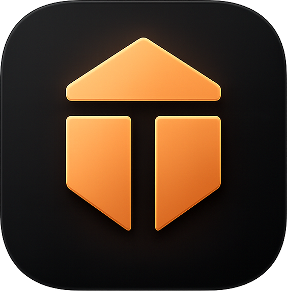
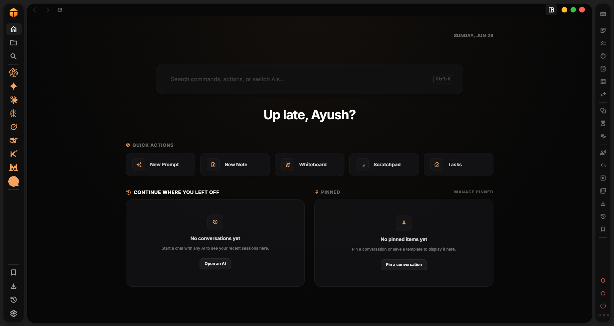
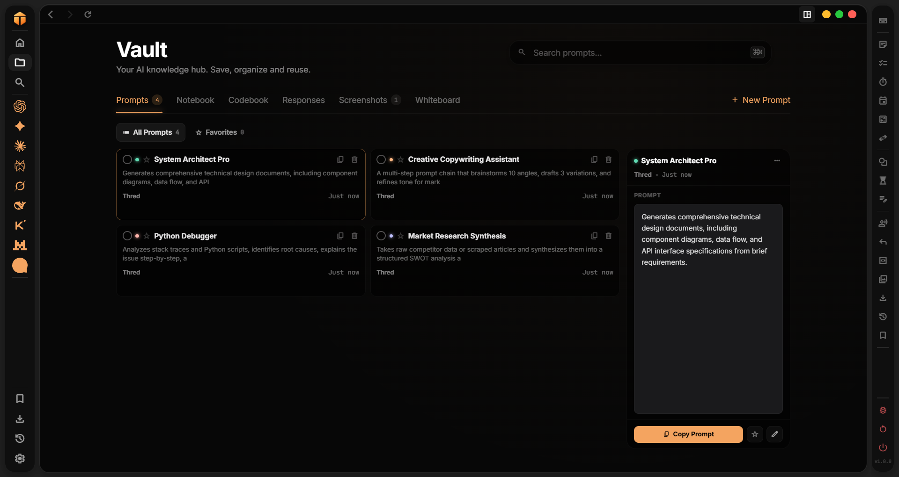
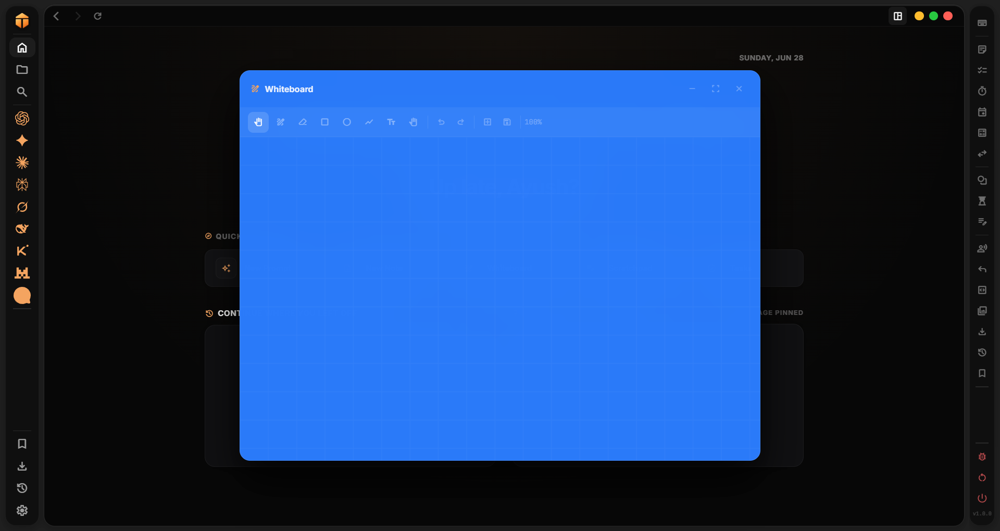

<p align="center">
  
</p>

<h1 align="center">Thred</h1>

<p align="center">
  <strong>Every AI. One workspace.</strong>
</p>

<p align="center">
  A desktop workspace where you can work with different AIs and save everything — all in one place.
</p>

<p align="center">
  <a href="https://github.com/i-ayushsingh/thred/releases/latest"></a>
  <a href="LICENSE"></a>
  <a href="https://github.com/i-ayushsingh/thred"></a>
  <a href="https://github.com/i-ayushsingh/thred"></a>
</p>

---

## Table of Contents

- [Features](#features)
- [Supported AIs](#supported-ais)
- [Installation](#installation)
- [Keyboard Shortcuts](#keyboard-shortcuts)
- [Documentation](#documentation)
- [Contributing](#contributing)
- [License](#license)

---

## Features

### Home



### Vault



### Whiteboard



### Left Sidebar

Navigation hub with 9 AI models, bookmarks, downloads, history, and settings — all accessible with a click or keyboard shortcut.

### Right Sidebar Tools

Floating productivity tools you can open, drag, and resize:

| Tool | Description |
|------|-------------|
| **Notes** | Rich text editor with checklists and auto-save |
| **Todo** | Today tasks and long-term tasks with priorities |
| **World Clock** | Local time + up to 5 world timezones |
| **Stopwatch** | Drift-free with lap recording |
| **Timer** | Custom countdown with focus presets (25/5/15 min) |
| **Calendar** | Month view with events and holiday indicators |
| **Calculator** | Standard + scientific modes with history |
| **Converter** | Length, weight, temperature, volume, currency, speed |
| **Whiteboard** | Drawing canvas with shapes, text, and zoom |
| **Pomodoro** | Focus sessions with breaks and statistics |
| **Scratchpad** | Quick temporary notepad |

### Vault

Save and organize everything across 6 tabs:

- **Prompts** — Save and reuse AI prompt templates
- **Responses** — Save AI responses for later reference
- **Codebook** — Code snippet management
- **Notebook** — Notes, todos, scratchpad, focus sessions, calendar events, calculations
- **Screenshots** — Captured screenshots with preview
- **Whiteboards** — Saved whiteboard canvases

### Topbar

Back/forward navigation, reload, new chat, split view, workspace capture, content capture, and bookmark button.

### Bookmarks

Save any AI conversation with auto-fetched chat names. 8 pinned bookmarks + 5 sidebar quick access slots.

### Downloads

Dedicated download manager with tabs by file type (images, videos, documents, code, audio) and built-in media viewer.

### Command Palette

Press `Ctrl+K` to search anything — AIs, actions, shortcuts, vault items. Quick access to everything.

### Keyboard Shortcuts

Full keyboard shortcut support for navigation, tools, capture, and more. See [KEYBOARD_SHORTCUTS.md](docs/KEYBOARD_SHORTCUTS.md).

---

## Supported AIs

| # | AI | Shortcut | URL |
|---|------|----------|-----|
| 1 | ChatGPT | `Alt+1` | chatgpt.com |
| 2 | Gemini | `Alt+2` | gemini.google.com |
| 3 | Claude | `Alt+3` | claude.ai |
| 4 | Perplexity | `Alt+4` | perplexity.ai |
| 5 | Grok | `Alt+5` | grok.com |
| 6 | DeepSeek | `Alt+6` | chat.deepseek.com |
| 7 | Kimi | `Alt+7` | kimi.ai |
| 8 | Le Mistral | `Alt+8` | chat.mistral.ai |
| 9 | HuggingChat | `Alt+9` | huggingface.co/chat |

Each AI runs in an isolated, sandboxed webview. Switch between them instantly with `Alt+1` through `Alt+9`.

---

## Installation

### Option 1: Download Installer (Recommended)

Download the latest release for your platform from the [Releases page](https://github.com/i-ayushsingh/thred/releases/latest).

### Option 2: Run from Source

```bash
git clone https://github.com/i-ayushsingh/thred.git
cd opencode
npm install
npm start
```

**Requirements:**
- Node.js 18+
- Windows 10/11

---

## Keyboard Shortcuts

| Shortcut | Action |
|----------|--------|
| `Ctrl+K` | Command Palette |
| `Ctrl+D` | Home |
| `Ctrl+L` | Vault |
| `Alt+1–9` | Switch AI |
| `Ctrl+\` | Split View |
| `Ctrl+Shift+S` | Content Capture |

See the full reference → [KEYBOARD_SHORTCUTS.md](docs/KEYBOARD_SHORTCUTS.md)

---

## Documentation

- [Features](docs/FEATURES.md) — Complete feature breakdown
- [Keyboard Shortcuts](docs/KEYBOARD_SHORTCUTS.md) — All keyboard shortcuts
- [FAQ](docs/FAQ.md) — Frequently asked questions
- [Troubleshooting](docs/TROUBLESHOOTING.md) — Common issues and fixes

---

## Contributing

Contributions are welcome! See [CONTRIBUTING.md](CONTRIBUTING.md) for how to run locally and submit PRs.

**What we're looking for:**
- Bug fixes and performance improvements
- New productivity tools
- Better AI site integration
- Documentation improvements

---

## License

MIT License — see [LICENSE](LICENSE) for details.

---

<p align="center">
  Built by <a href="https://github.com/i-ayushsingh">Ayush Singh</a>
</p>

<p align="center">
  <a href="https://thred.qzz.io">Website</a> · <a href="https://x.com/thred_launcher">Twitter/X</a> · <a href="https://www.linkedin.com/in/iayushsingh/">LinkedIn</a>
</p>
